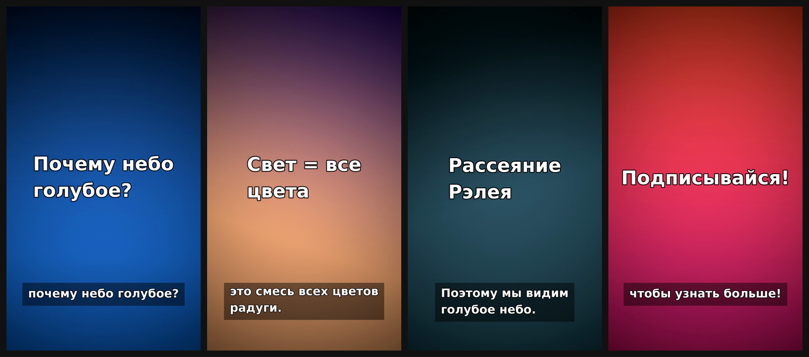

# Почему небо голубое

Format: 1080x1920 · 30 fps · voice: {'provider': 'edge', 'voice': 'ru-RU-DmitryNeural'}

| # | Time | Visual | On-screen text | Narration | SFX |
|---|---|---|---|---|---|
| 1 | 0.0–3.9s | text: Крупный заголовок на синем градиенте | Почему небо голубое? | Вы когда-нибудь задумывались, почему небо голубое? | whoosh@0.0s |
| 2 | 3.9–7.7s | text: Солнце и радуга | Свет = все цвета | Солнечный свет — это смесь всех цветов радуги. | chime@0.3s |
| 3 | 7.7–15.2s | text: Схема рассеяния | Рассеяние Рэлея | Попадая в атмосферу, синий свет рассеивается сильнее остальных. Поэтому мы видим голубое небо. | riser@1.0s, impact@3.1s |
| 4 | 15.2–18.1s | text | Подписывайся! | Подписывайтесь, чтобы узнать больше! | pop@0.4s, ding@0.6s |

**Total: 18.1 s**

