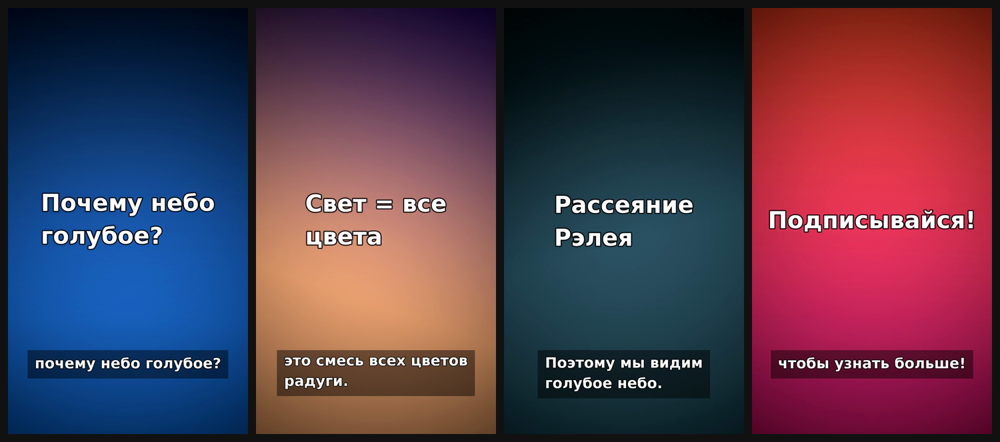

# video-forge — скилл Claude Code для создания видео

Скилл превращает идею или сценарий в готовое видео в три шага:

1. **Сценарий**: вы присылаете текст или описываете идею, и Claude пишет сценарий сам.
2. **Голос**: вы выбираете диктора, например *Adam*, Rachel, Josh (ElevenLabs), Dmitry или Svetlana (бесплатно) либо голос OpenAI.
3. **Сборка**: Claude разбивает сценарий на сцены, делает раскадровку, озвучивает каждую сцену, добавляет звуковые эффекты, фоновую музыку и субтитры, затем собирает `final.mp4`.



Пример результата: [`examples/demo/final.mp4`](.claude/skills/video-forge/examples/demo/final.mp4)
и [`storyboard.md`](.claude/skills/video-forge/examples/demo/storyboard.md).

## Установка

Нужны **Python 3.9+** и **ffmpeg**.

```bash
# ffmpeg
sudo apt install ffmpeg        # или: brew install ffmpeg

# бесплатная озвучка (необязательно)
pip install edge-tts

# скилл для всех проектов
git clone https://github.com/robloxvbvvh-design/Cloud-code.git
mkdir -p ~/.claude/skills
cp -r Cloud-code/.claude/skills/video-forge ~/.claude/skills/
```

Если открыть этот репозиторий в Claude Code, скилл подключится сам: он лежит в `.claude/skills/`.

### Голоса — 120 русских + 300 на других языках

Скилл включает **каталог из 120 голосов, которые говорят по-русски**. Все они бесплатные, ключи не нужны (нужен только `pip install edge-tts`):

- **14 основных голосов**: Дмитрий, Артём, Борис, Виктор, Филипп, Роман, Георгий, Хён, Светлана, Алина, Эмма, Серафима, Вера, Таисия.
- **56 вариантов манеры речи** для каждого из них: «молодой», «зрелый», «энергичный», «рассказчик». Например, «Артём энергичный».
- **50 голосов персонажей**: Робот, Андроид, Киборг, Великан, Тролль, Гном, Бурундук, Монстр, Демон, Зомби, Пришелец, Призрак, Злодей, Тёмный лорд, Дедушка, Бабушка, Мальчик, Девочка, Мультяшка, Радиоведущий, Голос по телефону, Диктор стадиона, Мегафон, Русалка, Космонавт, Трейлер кино, Сказочник, Фея и другие.

Послушать образцы 22 голосов: [`video-projects/voice-samples/final.mp4`](video-projects/voice-samples/final.mp4).

```bash
python3 $VF voices                        # весь каталог
python3 $VF voices --search злодей        # поиск
python3 $VF demo "Артём энергичный"       # послушать голос
python3 $VF demo "Дмитрий" --effect robot # голос с любым из 20 эффектов
```

В `storyboard.json` достаточно указать имя: `"voice": {"voice": "Робот"}`. Для диалога задайте каждому персонажу свой голос: `"characters": {"Артемия": {"voice": "Алина"}}`.

Другие голоса:

| Движок | Что нужно | Голоса |
|---|---|---|
| edge-tts | `pip install edge-tts`, бесплатно | 300+ голосов на 140+ языках: `vf.py voices --provider edge --lang ja` |
| ElevenLabs | `export ELEVENLABS_API_KEY=...` | Adam, Rachel, Antoni, Josh, Bella и любой voice_id из вашей библиотеки |
| OpenAI | `export OPENAI_API_KEY=...` | alloy, ash, coral, echo, fable, nova, onyx, sage, shimmer |
| silent | ничего | без озвучки |

Если выбранный голос недоступен (например, Adam без ключа ElevenLabs), скилл подставит ближайший доступный и сообщит об этом.

## Использование

В Claude Code:

```
/video-forge ролик на 30 секунд о том, почему небо голубое
```

или просто: «сделай видео…». Claude спросит сценарий и голос, покажет раскадровку и соберёт ролик.

Движок можно запускать и вручную:

```bash
VF=.claude/skills/video-forge/scripts/vf.py
python3 $VF check                         # что доступно
python3 $VF voices --provider edge --lang ru
python3 $VF sfx-list                      # встроенные эффекты и музыка
python3 $VF all video-projects/my-video   # озвучка + эффекты + сборка
python3 $VF render video-projects/my-video --scenes 2   # пересобрать сцену
```

Формат `storyboard.json` описан в [`references/storyboard-schema.md`](.claude/skills/video-forge/references/storyboard-schema.md).

## Возможности

- Форматы 9:16, 16:9, 1:1, 4:5.
- Фоны: анимированный градиент с заголовком, ваши картинки с движением камеры (zoom/pan) или ваши видео.
- Длительность каждой сцены подстраивается под озвучку.
- Субтитры синхронизированы с речью.
- 17 встроенных звуковых эффектов синтезируются через ffmpeg, скачивать ничего не нужно: whoosh, impact, riser, ding, pop, typing, heartbeat, rain и другие. С ключом ElevenLabs эффекты можно генерировать по текстовому описанию.
- Фоновая музыка: встроенные `pad`, `dark`, `bright` или ваш трек. Под голосом музыка автоматически приглушается (sidechain).
- Раскадровка: `storyboard.md` (таблица с таймкодами) и `storyboard.png` (кадры сцен).
