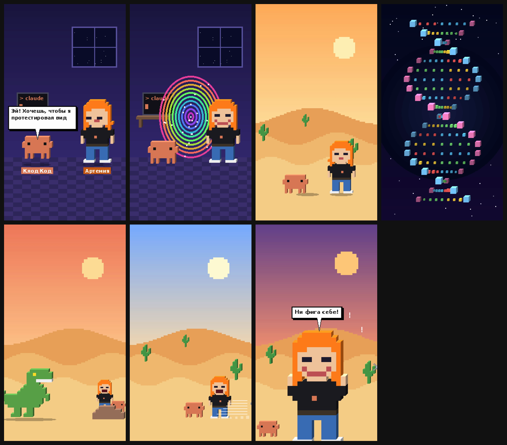

# Клод Код и Артемия

Format: 1080x1920 · 24 fps · voice: {'Клод Код': 'edge:ru-RU-DmitryNeural', 'Артемия': 'edge:ru-RU-SvetlanaNeural'}

| # | Time | Visual | On-screen text | Narration | SFX |
|---|---|---|---|---|---|
| 1 | 0.0–5.0s | video: Пиксельная 3D-комната. Клод Код прыгает и говорит, Артемия слушает |  | Эй! Хочешь, чтобы я протестировал видео и мои навыки? | pop@0.1s |
| 2 | 5.0–8.4s | video: Артемия соглашается, открывается портал и затягивает обоих |  | Давай! | ding@0.5s, portal@1.3s, whoosh@2.6s |
| 3 | 8.4–12.4s | video: Вспышка — герои падают в пиксельную пустыню, вокруг дюны и кактусы |  |  | wind@0.0s, impact@0.75s |
| 4 | 12.4–16.4s | video: Вращающаяся воксельная спираль ДНК в космосе |  |  | riser@0.0s, chime@1.9s |
| 5 | 16.4–21.4s | video: По пустыне шагает пиксельный тираннозавр, земля трясётся, герои прячутся за камнем |  |  | footstep@0.3s, footstep@0.9s, footstep@1.5s, roar@2.1s, footstep@3.3s, footstep@3.9s, footstep@4.5s |
| 6 | 21.4–24.4s | video: Мимо героев проносится котик |  |  | meow@0.4s, swoosh@1.0s |
| 7 | 24.4–27.8s | video: Крупный план: удивлённая Артемия, Клод Код подпрыгивает |  | Ни фига себе! | impact@0.25s, pop@1.6s |

**Total: 27.8 s**

