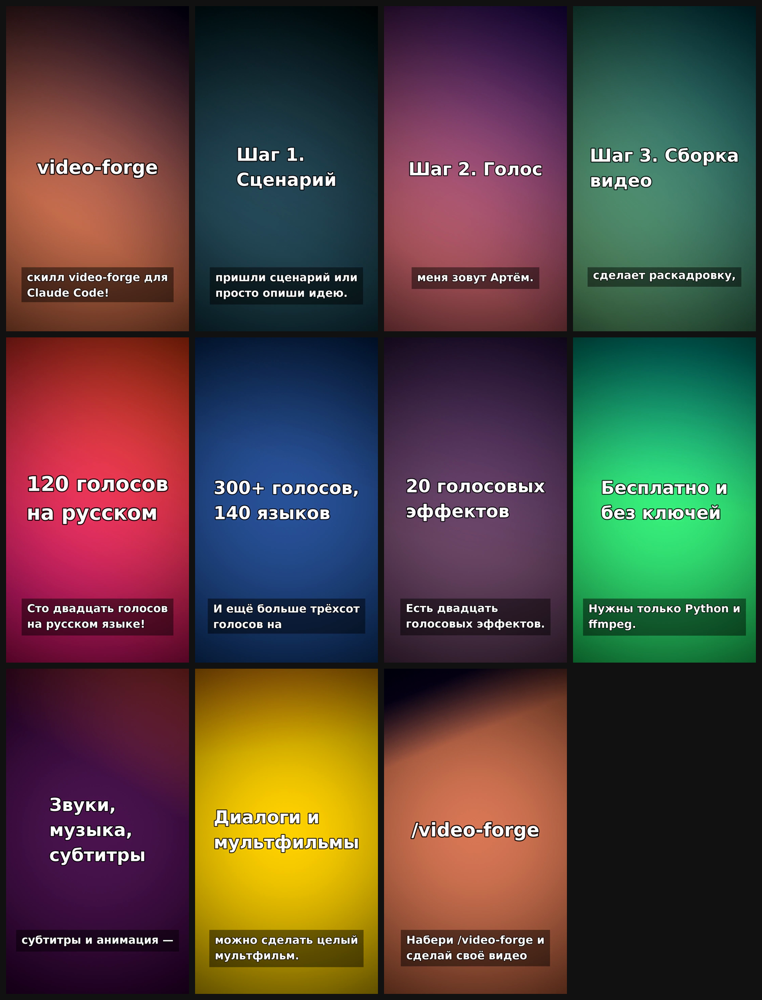

# video-forge: инструкция

Format: 1080x1920 · 30 fps · voice: {'narrator': 'edge:en-US-AndrewMultilingualNeural (Артём)'}

| # | Time | Visual | On-screen text | Narration | SFX |
|---|---|---|---|---|---|
| 1 | 0.0–7.0s | text | video-forge | Хочешь сделать видео за пару минут? Знакомься — скилл видео фордж для Клод Код! | whoosh@0s, impact@2.6s |
| 2 | 7.0–12.7s | text | Шаг 1. Сценарий | Как пользоваться? Шаг первый: пришли сценарий или просто опиши идею. | typing@2.0s |
| 3 | 12.7–18.0s | text | Шаг 2. Голос | Шаг второй: выбери голос. Например, меня зовут Артём. | pop@0.2s |
| 4 | 18.0–26.1s | text | Шаг 3. Сборка видео | Шаг третий: скилл сам разобьёт текст на сцены, сделает раскадровку, озвучку, звуки и музыку. | camera@2.5s |
| 5 | 26.1–30.8s | text | 120 голосов на русском | Сколько голосов? Сто двадцать голосов на русском языке! | riser@0.0s, impact@1.9s |
| 6 | 30.8–35.1s | text | 300+ голосов, 140 языков | И ещё больше трёхсот голосов на ста сорока языках. | chime@0.3s |
| 7 | 35.1–42.4s | text | 20 голосовых эффектов | Хочешь голос робота, великана или злодея? Есть двадцать голосовых эффектов. | glitch@1.0s |
| 8 | 42.4–51.2s | text | Бесплатно и без ключей | Почему он лучше? Голоса бесплатные, ключи не нужны. Нужны только Пайтон и эф эф эм пэг. | ding@0.4s |
| 9 | 51.2–58.2s | text | Звуки, музыка, субтитры | Двадцать один звуковой эффект, фоновая музыка, субтитры и анимация — всё внутри. | swoosh@0.2s |
| 10 | 58.2–63.6s | text | Диалоги и мультфильмы | Персонажи говорят разными голосами — можно сделать целый мультфильм. | pop@0.3s |
| 11 | 63.6–68.8s | text | /video-forge | Набери слэш видео фордж и сделай своё видео прямо сейчас! | pop@0.3s, applause@1.8s |

**Total: 68.8 s**

