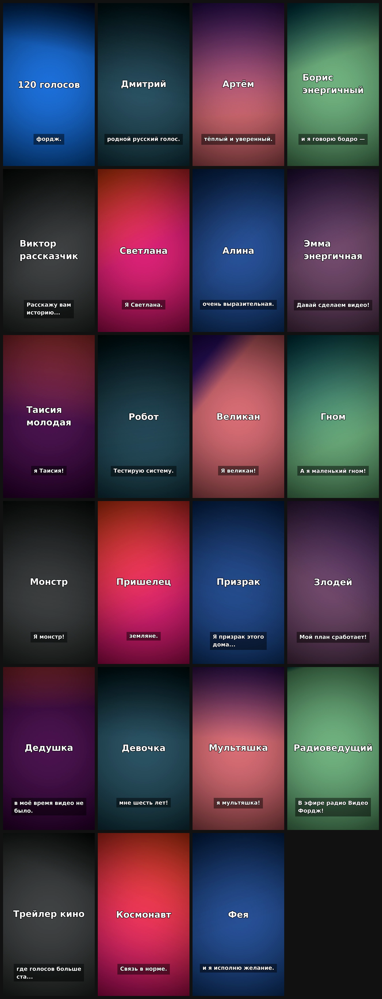

# Образцы голосов video-forge

Format: 1080x1920 · 30 fps · voice: {'narrator': 'edge:en-US-AndrewMultilingualNeural (Артём энергичный)', 'Дмитрий': 'edge:ru-RU-DmitryNeural (Дмитрий)', 'Артём': 'edge:en-US-AndrewMultilingualNeural (Артём)', 'Борис энергичный': 'edge:en-US-BrianMultilingualNeural (Борис энергичный)', 'Виктор рассказчик': 'edge:en-AU-WilliamMultilingualNeural (Виктор рассказчик)', 'Светлана': 'edge:ru-RU-SvetlanaNeural (Светлана)', 'Алина': 'edge:en-US-AvaMultilingualNeural (Алина)', 'Эмма энергичная': 'edge:en-US-EmmaMultilingualNeural (Эмма энергичная)', 'Таисия молодая': 'edge:pt-BR-ThalitaMultilingualNeural (Таисия молодая)', 'Робот': 'edge:ru-RU-DmitryNeural (Робот)', 'Великан': 'edge:ru-RU-DmitryNeural (Великан)', 'Гном': 'edge:ru-RU-DmitryNeural (Гном)', 'Монстр': 'edge:ru-RU-DmitryNeural (Монстр)', 'Пришелец': 'edge:en-US-AndrewMultilingualNeural (Пришелец)', 'Призрак': 'edge:en-AU-WilliamMultilingualNeural (Призрак)', 'Злодей': 'edge:ru-RU-DmitryNeural (Злодей)', 'Дедушка': 'edge:ru-RU-DmitryNeural (Дедушка)', 'Девочка': 'edge:pt-BR-ThalitaMultilingualNeural (Девочка)', 'Мультяшка': 'edge:en-US-EmmaMultilingualNeural (Мультяшка)', 'Радиоведущий': 'edge:en-US-BrianMultilingualNeural (Радиоведущий)', 'Трейлер кино': 'edge:ru-RU-DmitryNeural (Трейлер кино)', 'Космонавт': 'edge:ru-RU-DmitryNeural (Космонавт)', 'Фея': 'edge:fr-FR-VivienneMultilingualNeural (Фея)'}

| # | Time | Visual | On-screen text | Narration | SFX |
|---|---|---|---|---|---|
| 1 | 0.0–5.5s | text | 120 голосов | Сто двадцать голосов в скилле видео фордж. Послушайте некоторые из них! | whoosh@0s |
| 2 | 5.5–10.0s | text | Дмитрий | Привет! Я Дмитрий, родной русский голос. | pop@0.05s |
| 3 | 10.0–14.1s | text | Артём | Привет! Я Артём, тёплый и уверенный. | pop@0.05s |
| 4 | 14.1–17.6s | text | Борис энергичный | Я Борис, и я говорю бодро — для шортсов! | pop@0.05s |
| 5 | 17.6–21.9s | text | Виктор рассказчик | Я Виктор. Расскажу вам историю... | pop@0.05s |
| 6 | 21.9–25.5s | text | Светлана | Здравствуйте! Я Светлана. | pop@0.05s |
| 7 | 25.5–29.5s | text | Алина | Привет! Я Алина, очень выразительная. | pop@0.05s |
| 8 | 29.5–32.4s | text | Эмма энергичная | Я Эмма! Давай сделаем видео! | pop@0.05s |
| 9 | 32.4–34.7s | text | Таисия молодая | Привет, я Таисия! | pop@0.05s |
| 10 | 34.7–38.4s | text | Робот | Я робот. Тестирую систему. | pop@0.05s |
| 11 | 38.4–41.6s | text | Великан | Я великан! Бум! | pop@0.05s |
| 12 | 41.6–43.7s | text | Гном | А я маленький гном! | pop@0.05s |
| 13 | 43.7–46.9s | text | Монстр | Р-р-р! Я монстр! | pop@0.05s |
| 14 | 46.9–49.3s | text | Пришелец | Приветствую, земляне. | pop@0.05s |
| 15 | 49.3–52.7s | text | Призрак | Я призрак этого дома... | pop@0.05s |
| 16 | 52.7–56.7s | text | Злодей | Ха-ха-ха! Мой план сработает! | pop@0.05s |
| 17 | 56.7–59.9s | text | Дедушка | Эх, в моё время видео не было. | pop@0.05s |
| 18 | 59.9–62.8s | text | Девочка | А я девочка, мне шесть лет! | pop@0.05s |
| 19 | 62.8–65.8s | text | Мультяшка | Привет-привет, я мультяшка! | pop@0.05s |
| 20 | 65.8–68.3s | text | Радиоведущий | В эфире радио Видео Фордж! | pop@0.05s |
| 21 | 68.3–72.3s | text | Трейлер кино | В мире, где голосов больше ста... | pop@0.05s |
| 22 | 72.3–77.9s | text | Космонавт | Земля, приём. Связь в норме. | pop@0.05s |
| 23 | 77.9–82.5s | text | Фея | Я фея, и я исполню желание. | pop@0.05s |

**Total: 82.5 s**

